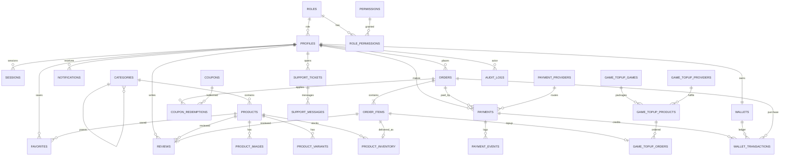

# Database Schema

PostgreSQL schema shared by Supabase (production) and embedded PGlite (development).
Migrations live in [`supabase/migrations`](../supabase/migrations). Money is `NUMERIC(12,2)`;
timestamps are `timestamptz`; primary keys are UUIDs (except reference/config tables).

## Entity relationship diagram



## Tables

### Identity & access
| Table | Key columns / notes |
|---|---|
| `roles` | id (`customer`, `support`, `finance`, `product_manager`, `admin`, `super_admin`), name, is_system |
| `permissions` | id (e.g. `payments.verify`), category, description |
| `role_permissions` | PK (`role_id`, `permission_id`) |
| `profiles` | id UUID (matches Supabase auth user), email + generated `email_lower` unique, scrypt `password_hash` (local only), username, display name, role, status, verification, last login |
| `sessions` | opaque token hash, IP/UA, expiry (local auth only) |
| `password_reset_tokens` | hashed single-use tokens (`reset`, `verify`) |

### Catalogue & inventory
| Table | Notes |
|---|---|
| `categories` | slug unique, TH/EN names, parent (one level), icon, accent, sort, active |
| `products` | slug unique, TH/EN, type, price/compare/cost, stock mode, stock quantity, sold count, delivery method, badge, featured, rating cache, JSON metadata |
| `product_variants` | per-product options with own price/stock |
| `product_images` | ordered image URLs |
| `product_inventory` | one row per sellable unit, `encrypted_payload` (AES-GCM), hint, status (`AVAILABLE/RESERVED/SOLD/DISABLED`), unique `order_item_id` |
| `favorites` | PK (user, product) |

### Orders & payments
| Table | Notes |
|---|---|
| `orders` | `order_number` unique, user, status/payment/delivery status, subtotal/discount/total, coupon snapshot, notes, timestamps |
| `order_items` | product snapshot, price, quantity, discount allocation, fulfilment state, encrypted manual delivery payload, top-up fields |
| `coupons` | code unique, percentage/fixed, limits, window, restrictions JSON, first-purchase |
| `coupon_redemptions` | unique (coupon, order); per-user limits counted from here |
| `payment_providers` | id, kind, enabled, non-secret JSON config, encrypted webhook secret |
| `payments` | unique reference, purpose, amount, status (`PENDING…REFUNDED`), QR payload, provider ref unique per provider, evidence, reviewer, expiry |
| `payment_events` | raw webhook payload, signature validity, IP (audit/replay evidence) |

### Money
| Table | Notes |
|---|---|
| `wallets` | PK user, balance `>= 0`, updated_at |
| `wallet_transactions` | signed amount, `balance_after`, unique reference, type (`deposit/purchase/refund/admin_credit/admin_debit/reversal`), links to payment/order/admin |
| `v_wallet_reconciliation` | view comparing stored balance to ledger sum |

### Game top-up
| Table | Notes |
|---|---|
| `game_topup_games` | slug, logo/banner, JSON field schema |
| `game_topup_providers` | adapter + encrypted config |
| `game_topup_products` | package, price, provider, delivery type |
| `game_topup_orders` | player fields snapshot, status (`PENDING/PROCESSING/COMPLETED/FAILED/REFUNDED/MANUAL_REVIEW`), processor, failure reason |

### Engagement & platform
| Table | Notes |
|---|---|
| `reviews` | one per order item, 1–5, moderation status |
| `support_tickets` / `support_messages` | ticket number, priority/status, internal notes |
| `notifications` | in-app, read_at |
| `banners` / `promotions` | scheduled homepage content |
| `audit_logs` | actor, action, entity, before/after JSON, IP/UA |
| `system_settings` | key → JSON value (branding, payment, legal) |
| `idempotency_keys` | scoped key, cached response, expiry |
| `rate_limits` | atomic fixed-window counters |
| `schema_migrations` | applied migration filenames |

## Constraints that matter

- `products.price >= 0`, `products.rating_avg BETWEEN 0 AND 5`
- `wallets.balance >= 0`
- `wallet_transactions.amount <> 0`, `balance_after >= 0`
- `order_items.quantity > 0`, monetary totals `>= 0`
- Unique: order number, payment reference, wallet reference, coupon code, product/category slug,
  `(provider_id, provider_ref)` for non-null provider refs, `order_item_id` for sold inventory,
  `(coupon_id, order_id)` for redemptions, one review per order item.
- Partial indexes target active products, available inventory, unread notifications, pending
  payments and user orders.

## Indexing

Every foreign key used in list/filter paths has an index: products by category/featured/created/
sold/type, orders by user/status/payment status/date, payments by user/status/order, wallet
transactions by user/type/date, inventory by product/status, notifications by user/read, audit by
date/entity, support by user/status/date, reviews by product/status.

## Row Level Security

All tables have RLS enabled. `anon`/`authenticated` grants are revoked first, then narrow grants
and policies are added:

- Public read: active categories/products/variants/images, active games/packages, scheduled
  banners/promotions, **approved** reviews (column-limited).
- Own data: profile (column-limited update: display name/username/avatar/phone), wallet, ledger,
  orders/items, payments, game top-ups, notifications (only `read_at` update), tickets/messages
  (non-internal), favourites.
- No client access to roles, coupons, inventory, payment providers/events, sessions, audit logs,
  settings, idempotency keys, rate limits.
- The application server uses a privileged connection and performs explicit authorization;
  RLS protects against direct PostgREST/anon access.

## Money & concurrency rules

1. Never write `wallets.balance` outside `applyWalletEntry`.
2. Every balance change and its ledger row commit together.
3. `SELECT ... FOR UPDATE` the wallet/payment/order rows.
4. Allocate inventory with `FOR UPDATE SKIP LOCKED`; require exactly the requested quantity.
5. Never delete delivered inventory or paid wallet transactions.
6. Refunds are new ledger entries, not edits.
7. Reconciliation: `select * from v_wallet_reconciliation where drift <> 0` must return zero rows.

## Migrations

```bash
npm run db:migrate
```

The runner applies files in filename order and records them in `schema_migrations`. Filenames
ending `.local.sql` are applied only to the embedded dev DB; `.supabase.sql` only to Supabase.
Never edit an applied migration in production — add a new one.

Local development automatically applies pending migrations on first DB access. Production should
run migrations explicitly before deploying.
